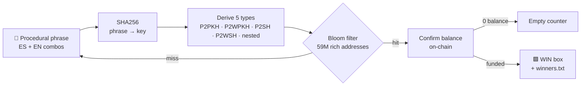

# BTBRAIN v1.0 ES+EN

<p align="center">
  
  
  
  
</p>

<p align="center">
  <b>Procedural brainwallet hunter (Spanish + English). No dictionaries.</b><br>
  It invents human-like phrases, hashes them into keys and checks 5 address
  types per key against a rich list — with a live outlaw-style console.
</p>

---

## ⚡ How it works



| Step | What happens | Cost |
| ---- | ------------ | ---- |
| Generate | combos, typos, keyboard walks, dates, MX slang | ~free |
| Derive | 1 key → 5 addresses (libsecp256k1) | ~3 µs |
| Bloom check | 5 lookups in 312 MB filter | ~ns |
| Confirm | HTTPS to mempool.space, **only on match** | rare |

## 🖥️ The console

```
  <red demon here>      ++================================++
                        || BTBRAIN v1.0 ES+EN              ||
                        || DB: cargada (59M)               ||
                        || Hilos: 8                        ||
                        || Frases: ES+EN generativas       ||
                        || Tipos: 5 por llave              ||
                        || Created by: VodK                ||
                        ++================================++
                          1. Cargar DB
                          2. Iniciar brain
                          3. Iniciar azar
                          4. Cambiar hilos
                          0. Salir
```

One live line while hunting (numbers only move, screen never scrolls):

```
Total WIN: (0) --- P2PKH(3130912) --- P2WPKH(3130912) --- P2SH(3130912) --- P2WSH(3130912) --- Emptys: 1 --- Frase: diosesamor2020 --- 300876/s
```

- `Escaneadas` → keys tried (fast)
- `P2PKH/P2WPKH/P2SH/P2WSH` → per-type bloom matches (almost always 0; movement = real event)
- `Emptys` → matches confirmed with **zero** balance (not saved, just counted)
- `WIN` → matches **funded** → green box + `winners.txt`
- `Frase` → live sample of what's being tried

## 🧠 Generation (no dictionaries, 6 odometers)

| # | Class | Space | Example |
| - | ----- | ----- | ------- |
| 0 | Singles + 89 mutators | ~27k | `amor` → `Amor123`, `4m0r`, `amor1997` |
| 1 | Pairs | ~900k | `diosesamor`, `te_amo` |
| 2 | Triples | ~162B | `luzdivinaeterna` |
| 3 | Keyboard walks | ~200 | `qwerty!`, `ytrewq123` |
| 4 | Numbers | ∞ | `19870514`, `5512345678` |
| 5 | Human templates ES+EN | ~245k | `teamojuan2020`, `jesussaves!` |

Typo engine included: swapped, doubled, dropped and fat-fingered letters —
the mistakes real humans make. Small classes retire automatically when
exhausted; counters persist in `brain_estado.txt`.

## 🔨 Build & run (Windows + MinGW-w64 gcc)

> Needs libsecp256k1 objects + OpenSSL headers/libs — see `build.bat`
> (`BTSCAN_SRC` / `CURLMINGW` env overrides). You also need a rich list:
> one address per line (`address<TAB>balance` also works), e.g. Pymmdrza's
> [Rich-Address-Wallet](https://github.com/Pymmdrza/Rich-Address-Wallet).

```
build.bat
run.bat                  :: menu: load DB once, hunt brain or random
btbrain.exe --db db.txt [--threads 8] [--azar] [--selftest]
```

Ctrl+C returns to menu (state saved). Concept inspired by Pymmdrza's
[BitcoinXPowerHunter](https://github.com/Pymmdrza/BitcoinXPowerHunter) —
rebuilt here in multithreaded C, ~1000× faster than the Python original.

## ✅ Verified, not promised

- `btbrain.exe --selftest` derives known vectors (checked against
  independent Python `ecdsa` + `base58` implementations).
- Every match is balance-checked on-chain before celebrating: bloom false
  positives stay silent.

## ⚠️ Honesty section

Weak brainwallets were drained years ago; a procedurally novel phrase almost
certainly never held funds. Odds per phrase are ~zero — this is a lottery
ticket, not income. Expect empties forever. If a WIN box ever opens, claim it
through a **private mempool relay** (public broadcast gets front-run).

## 📄 License

MIT — see [LICENSE](LICENSE). VodK, 2026.
